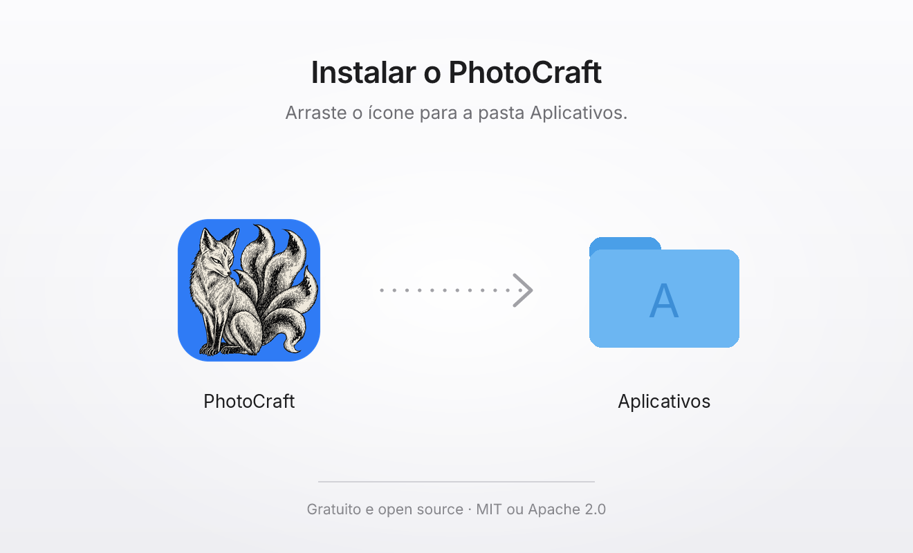
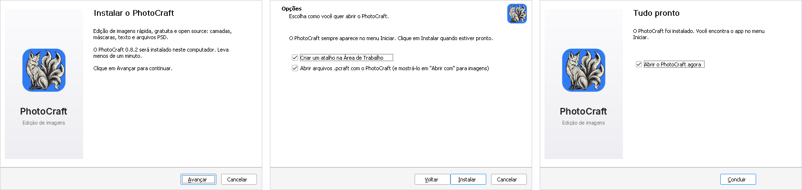

# Instaladores do PhotoCraft (.dmg e .exe)

Instaladores simples e no padrão Apple para o [PhotoCraft](https://github.com/storytold/photocraft),
o editor de imagens open source (camadas, máscaras, texto e arquivos PSD; MIT ou Apache-2.0) da equipe ArtCraft.

| Sistema | Arquivo | Como instala |
|---|---|---|
| macOS 11+ (Apple silicon e Intel) | `PhotoCraft-<versão>-macOS-Universal.dmg` | Abre uma janela e você arrasta o app para **Aplicativos** |
| Windows 10/11 x64 | `PhotoCraft-<versão>-Windows-x64-Setup.exe` | Assistente de 3 telas: Boas-vindas, Opções, Pronto |
| Windows 10/11 ARM | `PhotoCraft-<versão>-Windows-arm64-Setup.exe` | Igual ao x64 |

## Como gerar

1. No GitHub, abra **Actions › PhotoCraft installers › Run workflow**.
2. Em *ref*, deixe `main` (ou informe uma tag do PhotoCraft, como `v0.8.2`) e clique em **Run workflow**.
3. Quando terminar (cerca de 30 a 45 minutos: o PhotoCraft é compilado do zero), os instaladores
   aparecem na aba **Releases** do repositório, como `PhotoCraft <versão>`. É só baixar o `.exe` ou
   o `.dmg` e abrir.

O workflow está em [`.github/workflows/photocraft-instaladores.yml`](../.github/workflows/photocraft-instaladores.yml).
Ele baixa o código do PhotoCraft, compila com os scripts do próprio projeto e empacota com os arquivos
desta pasta. No Windows ele também instala o `.exe` em silêncio, roda o `photocraft-cli --version` e
desinstala, para garantir que o instalador funciona.

## macOS: o DMG



- Janela limpa de 660 × 400 pt, sem barra de ferramentas nem barra lateral, com fundo claro, título,
  instrução curta e uma seta do app para **Aplicativos**, como nos apps da Apple.
- Fundo HiDPI (1x e 2x no mesmo TIFF), nítido em telas Retina.
- O disco montado mostra o ícone do PhotoCraft.
- Binário universal: um único DMG para Mac com Apple silicon e Intel.
- O layout já vem pronto (`macos/DS_Store`), então o DMG é gerado sem AppleScript nem Finder,
  e o build no CI não trava.

**Assinatura.** Sem certificado, o app sai com assinatura *ad-hoc*. Na primeira vez, o macOS pede
confirmação: clique com o botão direito em PhotoCraft, em **Aplicativos**, e escolha **Abrir**
(ou vá em *Ajustes do Sistema › Privacidade e Segurança › Abrir Mesmo Assim*). Para um DMG que abre
sem esse aviso, cadastre estes *secrets* no repositório (requer uma conta Apple Developer):

| Secret | O que é |
|---|---|
| `APPLE_CERTIFICATE` | Certificado *Developer ID Application* (.p12) em base64 |
| `APPLE_CERTIFICATE_PASSWORD` | Senha do .p12 |
| `APPLE_ID`, `APPLE_PASSWORD`, `APPLE_TEAM_ID` | Apple ID, senha de app e Team ID para a notarização |

Com eles, o app e o DMG saem assinados, notarizados e com o ticket da Apple anexado.

## Windows: o .exe



- Assistente moderno do [Inno Setup](https://jrsoftware.org/isinfo.php), com arte do PhotoCraft em
  todas as escalas de tela (100% a 250%).
- **Três telas e nada mais:** Boas-vindas › Opções (atalho na Área de Trabalho e abrir arquivos
  `.pcraft`) › Pronto, com "Abrir o PhotoCraft agora" marcado.
- **Sem pedir senha de administrador:** instala só para o usuário atual, em
  `%LOCALAPPDATA%\Programs\PhotoCraft`. Para instalar para todos os usuários (em *Arquivos de
  Programas*), rode o instalador com `/ALLUSERS`.
- Português do Brasil ou inglês, conforme o idioma do Windows.
- Registra `.pcraft` e adiciona o PhotoCraft ao "Abrir com" de PSD, PNG, JPEG, WebP, HEIC, TIFF,
  BMP, GIF, ORA, KRA e PDN sem mudar o app padrão desses arquivos.
- Inclui o `photocraft-cli.exe` (servidor MCP e exportação em lote) e funciona com `photocraft` no
  **Executar** (Win+R).
- Desinstala pelo *Configurações › Aplicativos*, removendo o app, os atalhos e os registros.
- Não precisa do Visual C++ Redistributable.

Instalação silenciosa (para TI):

```bat
PhotoCraft-0.8.2-Windows-x64-Setup.exe /VERYSILENT /SUPPRESSMSGBOXES
PhotoCraft-0.8.2-Windows-x64-Setup.exe /VERYSILENT /SUPPRESSMSGBOXES /ALLUSERS
```

O `.exe` não é assinado digitalmente, então o SmartScreen pode mostrar "O Windows protegeu o
computador". Clique em **Mais informações › Executar assim mesmo**. Para remover o aviso, é preciso um
certificado de assinatura de código.

## Arquivos

| Arquivo | O que é |
|---|---|
| `macos/criar-dmg.sh` | Monta, assina e (opcionalmente) notariza o DMG a partir do `PhotoCraft.app` |
| `macos/background.tiff`, `macos/DS_Store` | Fundo e layout da janela do DMG (gerados) |
| `windows/photocraft.iss` | Script do instalador Inno Setup |
| `windows/assistente-*.bmp` | Imagens do assistente em 7 escalas (geradas) |
| `arte/dmg-fundo.svg` | Arte-fonte do fundo do DMG |
| `arte/gerar.py` | Gera as imagens acima a partir do ícone e das fontes do PhotoCraft |

Para mudar a arte, edite `arte/dmg-fundo.svg` (ou as constantes de `arte/gerar.py`) e rode, em qualquer
sistema:

```sh
pip install 'pillow>=12' ds_store==1.3.3 mac_alias==2.2.3
cargo install resvg
git clone https://github.com/storytold/photocraft /tmp/photocraft
python3 instalador-photocraft/arte/gerar.py /tmp/photocraft
```

## Créditos

PhotoCraft © 2026 ArtCraft Team e colaboradores, sob MIT ou Apache-2.0. O ícone do app tem a mesma
licença ([assets/app-icon/LICENSE.txt](https://github.com/storytold/photocraft/blob/main/assets/app-icon/LICENSE.txt)).
Fonte Inter sob SIL OFL 1.1. A geração do `DS_Store` segue `packaging/macos/dmg/generate.py` do
PhotoCraft. Estes instaladores não usam as marcas ArtCraft.
